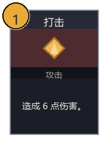

# 单张卡牌：复用 Miliastra Image Editor 导出器

关联共同 Spike **TASK-10.1**，本分支仅交付卡牌最小实验；总任务由主 Agent 汇总，不关闭 Spike。

本实验只制作一张「打击」卡牌，证明**上游导出链可以保留静态图片图元、原生中文文本、坐标与层序**。导出与 VM 契约检查通过；**未平台编译、未写入存档、未真机验证**。不可据此批量制作卡牌或宣布 UI 已实现。



## 交付物

| 文件 | 用途 |
|---|---|
| [`card.source.json`](../../art/spikes/card-editor/card.source.json) | 本项目构造的上游场景输入，15 个图元 |
| [`card.json`](../../art/spikes/card-editor/card.json) | 上游规范化可编辑 JSON，可经 Import → JSON 继续编辑 |
| [`card.lua`](../../art/spikes/card-editor/card.lua) | 上游原样导出客户端脚本，模板索引仍为 0 |
| [`card.gia`](../../art/spikes/card-editor/card.gia) | 上游素材组导出，包含 11 个图片控件与 4 个原生文本框 |
| [`card.gia-document.json`](../../art/spikes/card-editor/card.gia-document.json) | 上游 GIA 中间文档，方便人工对照中心坐标 |
| [`card.png`](../../art/spikes/card-editor/card.png) | 上游 Pillow 预览，透明底 180×240；不是游戏截图 |
| [`verification.json`](../../art/spikes/card-editor/verification.json) | 输入/输出 SHA-256、版本、检查项目与未验证状态 |
| [`export-card-spike.py`](../../scripts/art/export-card-spike.py) | 单样例数据构造与上游导出调用，未实现格式转换器 |

卡框实际 148×208，画布四周各留 16，容纳左上费用圆。内容从 `data/cards.json` 的 `strike` 读取（名称「打击」、费用1、说明「造成 6 点伤害。」），没有写入玩法逻辑。主题值读取 `data/presentation/ui_theme.json`；设计遵循已批准 PR #19 / [`UI_DESIGN.md`](../design/UI_DESIGN.md)。卡图用琥珀岩晶几何占位，**不代表该基础攻击获得岩元素机制**。

## 复用入口与版本

上游：[1475505/Miliastra-image-editor-webui](https://github.com/1475505/Miliastra-image-editor-webui)，固定提交 [`103025f9095d8089e3f9bf097f4d0c5fe039d546`](https://github.com/1475505/Miliastra-image-editor-webui/tree/103025f9095d8089e3f9bf097f4d0c5fe039d546)。本地只读 checkout 位于 `tools/vendor/image-editor`，不纳入本 PR。

脚本直接调用 `backend/app/main.py` 的 `import_scene`、`export_json`、`export_lua`、`export_gia`、`export_png` 与 `scene_to_gia_document`。这些也是 `/api/import`、`/api/export/{json,lua,gia,png}` 的后端处理函数。未启动 Web 服务、未安装前端依赖、未修改上游、未调用 WebMCP、miliastra MCP 或任何 GUI。

Python 3.13.12、Node 22.22.1 已存在；系统 Pillow 12.3 超出上游 `<12` 的约束，因此在上游目录创建隔离 venv。实际导出使用 FastAPI 0.159.1、Pillow 11.3.0、Pydantic 2.14.1、Uvicorn 0.54.0；完整依赖见 [`requirements.lock.txt`](../../art/spikes/card-editor/requirements.lock.txt)。Node 只用于已有 Fengari 契约检查。

## 可重复命令（PowerShell）

以下在本实验 worktree 根运行；`$repoRoot` 指主仓库根，可按机器位置调整。首次 clone 在网络受限环境需要网络授权，不需启动游戏。

```powershell
$repoRoot = 'F:/New folder'
$editorRoot = Join-Path $repoRoot 'tools/vendor/image-editor'
git clone https://github.com/1475505/Miliastra-image-editor-webui $editorRoot
git -C $editorRoot checkout 103025f9095d8089e3f9bf097f4d0c5fe039d546
python -m venv "$editorRoot/backend/.venv"
$exportPython = "$editorRoot/backend/.venv/Scripts/python.exe"
& $exportPython -m pip install -r art/spikes/card-editor/requirements.lock.txt
& $exportPython scripts/art/export-card-spike.py --editor $editorRoot
```

预期输出：`controls=15`、`images=11`、`nativeTextboxes=4`，检查包括 JSON/Lua 回导、GIA 原生 UTF-8 文本、坐标、图片资产和绘制顺序。脚本检查上游 HEAD，版本不符会停止。默认参数固定为 `BASE_SCALE=1`、`OFFSET_X=0`、`OFFSET_Y=0`，不修改模板索引。

已有 checkout 时跳过 clone；仅生成本卡，不提供批量参数。PNG 字体由上游自动选择：本机未安装汉仪文黑，落到 Windows 微软雅黑，字形与游戏实际字体可能不同；不分发字体。

### 已执行的验证

```powershell
# 在本实验 worktree：使用现有 battle-ui 的 Fengari（只读取依赖）
node "$editorRoot/backend/tests/check_textbox_lua.cjs" `
  "$repoRoot/.worktrees/battle-ui/node_modules/fengari" `
  art/spikes/card-editor/card.lua art/spikes/card-editor/card.json

# 在上游 backend 目录：
& .venv/Scripts/python -m unittest discover -s tests -p test_textbox_gia.py -v
& .venv/Scripts/python -m unittest discover -s tests -p test_lua_scene.py -v
& .venv/Scripts/python -m unittest discover -s tests -p test_canvas_contract.py -v
```

结果：上游相关 31 项测试通过；Fengari checker 检查本样例的15控件、整数大小、样式、自适应、混合图层、缺失模板绑定和销毁路径，通过。PNG 已目视检查中文、边框、费用圆未裁断。没有新增游戏功能，无需以整库规则测试代替这些针对性检查。

GIA 验证用上游另一个只读二进制解析模块 `vendor/primitive_shape/gia_lua.py` 的字段/变换读取函数，检查**实际 GIA**的 GUID 子序、11 个静态图片资产与几何、4 个原生文本框消息和中文 UTF-8。该模块的 `parse_material_gia` 是旧「只含图片」入口，会拒绝混入原生文本的 GIA，不能用它将本文件完整回导为 Lua；本样例 Lua 由上游当前 `export_lua` 正确分开处理图片和文本。

## 模板与静态图片/文字 API

| 编号 | 含义 | 本样例 |
|---|---|---|
| 静态图片资产 ID | `SetImage(Enum.ImageSource.StaticReference, id)` 的图库编号 | 100001 矩形、100002 圆、100003 三角形 |
| `IMAGE_PREFAB_ID` | 官方编辑器中「图片控件」的控件模板索引 | **未知**，导出保留0 |
| `TEXTBOX_PREFAB_ID` | 官方编辑器中「文本框控件」的控件模板索引 | **未知**，导出保留0 |

两种控件模板都要设为「仅存为模板」。上游运行时用 `game.InstantiateClientUIControl(index, parent)` 创建控件。**图库 ID、素材组 GUID、元件 ID 均不能代填模板索引**。本实验不猜测账号内真实索引，需主 Agent 在官方编辑器取证。

Lua 图片使用 `SetImage`、`imageColor`、`SetSizeDelta`、居中锚点/轴心、`SetAnchoredPosition`、`SetLocalRotation`。文字使用独立原生文本框：`text`、`fontSize`、`minimumFontSize`、`adaptiveFontSize`、`fontColor`、`bgColor`、`enableOutline`、`horizontalAlignment`、`verticalAlignment`，没有把中文转为图形。上游还对 `imageType` 做保护性设置，本样例只使用基础类型，不依赖拉伸映射。

`Color.FromRGBA` 额外做了已安装 MCP 代码的只读核对：`D:/MiliastraTools/genshin-miliastra-mcp/knowledge/official/guide/mhtakr07vej4.md:141` 的官方文档加工快照明确记录 `Color.FromRGBA(r,g,b,a?)` 接受0–255；`src/scene/client-api.json:69` 的 methods 包含 `FromRGBA`。直接导入本地 `src/client-check.mjs` 的 `luaSyntaxError(card.lua)` 返回 `null`，`SetImage`、`InstantiateClientUIControl` 也在其 API 目录。**没有调用 MCP 工具，也未运行 `scene_check_client`**。该校验器泛型方法名分支检查冒号调用，`Color.FromRGBA` 的点调用本身不由该分支验证；API目录/语法通过仍不等于游戏调用成功。导出使用 `Color.FromRGBA`，未将其改写为其他构造形式。

模板索引补全后，脚本应挂在**专用空客户端容器**，不要挂模板本身，也不要挂生产界面根节点。运行时会重设宿主尺寸、缩放与位置，且负责清理自己创建的控件。此文件是独立显示探针，**不是战斗组件脚本**，没有卡牌命令、点击或绑定核心状态。

GIA 路径无需在本文件里填写 Lua 模板索引，但上游使用的是旧 class15 超限素材组模板；它是否能在本人当前7.1编辑器导入、原生文字是否保留、导入后如何作为客户端控件使用，都仍需验证，不视作即插即用战斗卡牌。

## 坐标、层序与平台适配

源场景 `x/y` 为图元中心，X向右、Y向下；`zIndex` 大的在上，规范化后连续编号。导出到居中、Y向上的平台约定：`xPlatform=x−90`、`yPlatform=120−y`（本画布180×240）。旋转Z为逆时针，本样例仅两块岩晶矩形45°。

| 图元 | 场景中心 | 平台中心 |
|---|---|---|
| 卡框 | (90,120) | (0,0) |
| 中文标题 | (90,33) | (0,87) |
| 岩晶中心 | (90,80) | (0,40) |
| 费用圆/数字 | (26,26) | (−64,94) |
| 说明文本 | (90,174) | (0,−54) |

层序从下到上为：基础灰框 → 深色内板 → 名称条 → 攻击底色 → 三层岩晶 → 类型条 → 标题/类型/说明文字 → 三层费用圆 → 费用数字。上游 `DRAW_ORDER` 混排图片/文本，实例化后 `SetAsLastSibling`；GIA 的二进制资源实体顺序不等于显示顺序，显示序使用素材组子 GUID 关系。

差异与降级：类型条字号用主题最小14（原型CSS演示为12）；费用外圈用三个实心圆叠加还原细描边，不引入 mask；说明数字暂未分金色富文本，当前统一原生文本颜色；卡图是几何占位。无阴影/渐变、活动蒙版、Prefab、动态引用、拉伸、旋转X/Y，保留 GIA/Lua 共同子集。

作为单独探针可在1280×720画布居中以1倍检查。正式接入必须遵守主 `stage` 的 `min(宽/1280,高/720)` 规则，避免宿主再次设置缩放造成双重缩放；本实验没有调整生产 stage，也没有验证多设备。

## 许可证与证据边界

上游仓库声明 GPL-3.0，许可证原文保存在 [`EDITOR-GPL-3.0.txt`](../../art/spikes/card-editor/licenses/EDITOR-GPL-3.0.txt)。其 primitive-shape 导出运行时来自 LiuL，MIT，原文及版权保存在 [`PRIMITIVE-SHAPE-MIT.txt`](../../art/spikes/card-editor/licenses/PRIMITIVE-SHAPE-MIT.txt)；来源说明见上游 `backend/vendor/primitive_shape/PROVENANCE.md`。导出 Lua 包含上游运行时和应用适配代码，因此随小样一并保留上述来源与许可材料。本实验没有复制上游框架进项目，也没有使用其他创作者的美术或存档；生成文件不应视作无来源代码。

| 层 | 结果 |
|---|---|
| 可编辑数据与本地导出 | 通过，JSON/Lua/GIA/PNG均已生成 |
| 格式读取与Lua VM契约 | 通过，见上述命令和 `verification.json` |
| 平台脚本编译 | **未执行** |
| 写入/导入存档副本 | **未执行** |
| 游戏中文/图层/费用圆显示 | **未执行** |
| 模板真实索引 | **未知，需主 Agent 取证** |
| 手机/电脑/主机适配 | **未执行** |
| 批产门禁 | **未放行**，先由主 Agent 验证这一张 |

交给主 Agent 的最小验证：先在临时副本导入 `card.gia` 核对4原生文本框及前后层；另取得图片/文本模板索引后，在临时专用容器挂 `card.lua`，检查「打击」「攻击」「造成 6 点伤害。」「1」均显示，费用圆完整、说明不溢出、切换重入不重复创建。分别记录导入、编译、实机结果与截图，再决定该管线是否适合下一张卡。本任务没有操作正式存档、上传或发布。
