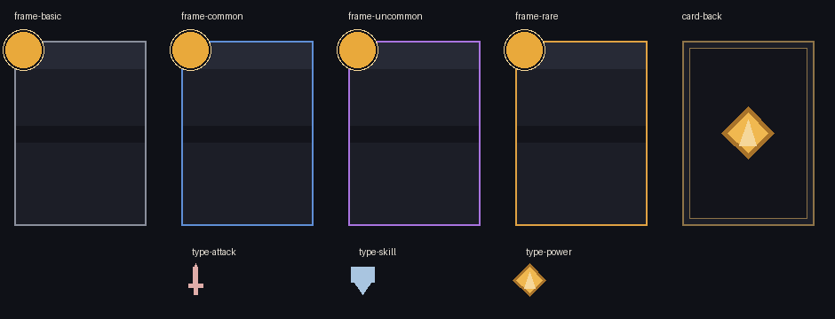

# TASK-25.1 · 共享卡牌资产

2026-10-23。沿用用户批准的 PR #19、[UI_DESIGN.md](../design/UI_DESIGN.md)、[主题数据](../../data/presentation/ui_theme.json)，以及主 Agent 已实机核对的电脑单卡高度兼容流程。**本目录的新资产只完成离线制作和下述本地检查，未导入存档、未经过官方编译或实机验收。**



## 最小套件与成本

实际 `data/cards.json` 为37张：四种稀有度、三种类型。制作计划选择4框+1背+3图标，不生成稀有度×类型12种组合，也不复制37份卡面。步骤为：读取主题/实际数据 → 原上游导出 → 目视检查和上游/VM契约核对。只新增本说明、一个数据制图脚本和 `art/cards/shared/`。

| ID / 文件前缀 | 画布 / 可见主体 | 图片控件 | 原生文字控件 | 用途 |
|---|---|---:|---:|---|
| `frame-basic` | 180×240 / 148×208 | 8 | 4 | 基础灰 #8A8F9C |
| `frame-common` | 同上 | 8 | 4 | 普通蓝 #5F8FD6 |
| `frame-uncommon` | 同上 | 8 | 4 | 罕见紫 #A974E0 |
| `frame-rare` | 同上 | 8 | 4 | 稀有金 #E0A243 |
| `card-back` | 180×240 / 148×208 | 7 | 0 | 深岩灰蓝、暗金细框、岩晶；无稀有度信息 |
| `type-attack` | 40×40 | 4 | 0 | 单剑轮廓 |
| `type-skill` | 40×40 | 2 | 0 | 盾牌轮廓 |
| `type-power` | 40×40 | 3 | 0 | 单卡验证样式的三层岩晶 |

各项有 `.source.json` 可编辑输入、`.json` 上游规范化场景、`.lua` 原生控件导出、`.png` 离线预览。未生成GIA，避免把未验证的素材组路线混为当前Lua制作路线。完整元素ID、1起的绘制序号、尺寸、场景中心和平台中心见 [manifest.json](../../art/cards/shared/manifest.json)，版本/哈希/检查边界见 [verification.json](../../art/cards/shared/verification.json)。哈希对文本统一CRLF→LF，PNG按原字节，避免Git自动换行产生假差异。

共享框是**12控件的空内容壳**，不是单张2控件边框。相对已验证的11图+4字探针，仅移除3层岩晶占位，保留8图+4空字槽。组合后攻击/技能/能力卡分别为16/14/15控件；不含宿主、点击区域、诊断控件、选中光晕或控制器。不能把原单卡15控件与本框成本相加，也不能重建一套重复文字槽。

## 规格与差异

- 所有颜色、字号、主体尺寸和间距读取主题。四框只在稀有度色上不同；插图区保持中性 `panel`，等待真实卡类型绑定时使用 `manifest.artTint`（主题类型色32%混合panel）。这样不把攻击类型写进全部框。
- 名称条高30，类型条高18；**透明原生标题/类型框仍为h40**，中心分别为(90,33)/(90,121)，字号17/14。说明框132×92、字号15、中心(90,174)；费用40×40、字号22、中心(26,26)。全部自适应、最小14，背景透明，不把中文转成图元。内容均为空，不能用空槽离线预览证明中文已显示。
- 场景X向右、Y向下；平台中心换算 `x−画布宽/2`、`画布高/2−y`。卡框中心为(90,120)，平台中心为(0,0)。费用圆最外46×46，边界位于(3,3)至(49,49)，画布留白保留它的外伸。旋转后边界也做了检查。
- 原型类型图标预定图库ID为攻击102012、技能102014、能力102024；本套用已验证的矩形100001、圆100002、三角100003组成可编辑低成本轮廓。**这是一项制作降级**：维持剑/盾/岩语义和类型配色，未声称等同图库图形。剑改为直立以保持4图元接缝连续；盾下半部简化为三角，能力复用已验证岩晶而非原型SVG的中空六角纹。正式图库ID仅在manifest记录待接入核对，未写进本套Lua。
- 卡背没有既有完整批准稿，使用批准的直角细边、深色板和单卡岩晶语言作最小延伸，未新增图案体系。没有圆角、渐变、蒙版、Prefab、图片拟合、旋转X/Y或新运行时框架。

## 接入边界

两种**控件模板索引保持0**，由主Agent绑定本人官方编辑器返回的真实值；图库100001/100002/100003绝不能代填模板索引。图片与文字模板设为「仅存为模板」，关闭模板遮罩/羽化。

每份Lua是原上游的**独立显示导出**，应挂在专用空客户端容器；会设置宿主尺寸/位置/缩放并清理自身创建的控件。不能直接挂生产stage、已有卡牌根节点，或把多个导出Lua叠挂同一宿主。本套没有交互、状态绑定、出牌命令或控制器，不作为即插即用战斗组件。

真正拼装卡面时，在可编辑场景中选一份稀有度框，复用其中四个空文字槽，从核心状态和中文表现层填值；费用X按实际`costMode`绑定。将一枚类型图标的场景中心从(20,20)平移到框的(90,80)，即场景偏移(+70,+60)，插入art-panel之后、type-band与文字之前，重新分配zIndex后仍走原上游导出。此时说明/名称/费用各只有一份。主stage缩放按UI规范，避免宿主再缩放引发双重缩放。该组合和文字绑定属于后续界面集成，本任务未导出示例组合冒充完成。

## 重现与本地证据

固定上游 `F:/New folder/tools/vendor/image-editor`，提交 `103025f9095d8089e3f9bf097f4d0c5fe039d546`。脚本先检查提交，只导入并调用该版本JSON/Lua/PNG导出器，不修改上游、不复制环境。Python及依赖版本记录在verification。以下命令在本工作树运行：

```powershell
npm ci --ignore-scripts
& 'F:/New folder/tools/vendor/image-editor/backend/.venv/Scripts/python.exe' `
  scripts/art/export-card-shared.py --editor 'F:/New folder/tools/vendor/image-editor' `
  --fengari node_modules/fengari
```

省略 `--fengari` 可只导出和做格式检查，报告会明确VM未执行。生成器会覆盖本套输出；手动改稿可在原上游导入`.source.json`继续编辑再导出，勿直接手改Lua运行时。Fengari使用本工作树既有lock安装，未更改依赖声明/lock或他人环境。

| 检查层 | 本轮结果 |
|---|---|
| 8项JSON→上游规范化→Lua→回导 | 通过；实际规范化元素逐项相等 |
| 顺序、仅基础图库ID、旋转后边界、空原生槽h≥40/字号≥14、模板0 | 通过；导出脚本断言 |
| 8份Lua语法 | 通过；Fengari公开VM parser解析实际导出文件 |
| 4份含文字框Lua VM契约 | 通过；原上游`backend/tests/check_textbox_lua.cjs`，每份12控件，覆盖文字样式、层序、模板缺失与重复启动清理 |
| 卡背/类型图标图片运行时VM | 未执行；仅语法与数据回导，不借文字框契约扩大结论 |
| 上游`test_lua_scene.py` | 18项通过 |
| 上游`test_textbox_font.py` | 字体回退1项通过；另2项因TemporaryDirectory新目录ACL拒写而未完成，换到本worktree临时目录仍失败；不归为字体功能通过 |
| 离线PNG目视 | 已逐项通过审查图核对；首版断开的斜剑已修为连续直剑；PNG不复现原生短文字框问题 |
| 官方平台编译 / 存档副本导入 / 新资产实机 | 均未执行 |
| 十卡长文案、选中缩放/点击控制器、手机/主机 | 均未执行 |

原有电脑单卡探针通过的结论仅是制作路线的依据；不覆盖这八项新资产或其任意组合。主Agent需统一绑定、组装，再分别记录平台编译、存档导入和目标设备验证。没有操作MCP、GUI、官方存档、上传或发布。

## 来源与许可

本套几何源稿由本项目此次编制；主题、布局和语义来自仓库PR #19，不使用其他创作者资产、存档或第三方图片。PNG由本地原上游渲染，不含打包字体文件，中文保持原生空文字槽。

Lua导出含原上游Image Editor适配运行时代码，上游声明GPL-3.0，保留原文 [EDITOR-GPL-3.0.txt](../../art/cards/shared/licenses/EDITOR-GPL-3.0.txt)。其 primitive-shape 导出器/运行时来自LiuL，MIT，保留版权和原文 [PRIMITIVE-SHAPE-MIT.txt](../../art/cards/shared/licenses/PRIMITIVE-SHAPE-MIT.txt)。上游`backend/vendor/primitive_shape/PROVENANCE.md`记录来源为本地`Miliastra-toolbox-primitive-shape`，无可用提交SHA；本套通过固定Image Editor提交追踪所用副本。导出Lua并非无来源代码，不将这两份许可证扩大解释为其他官方图库资源的授权。
