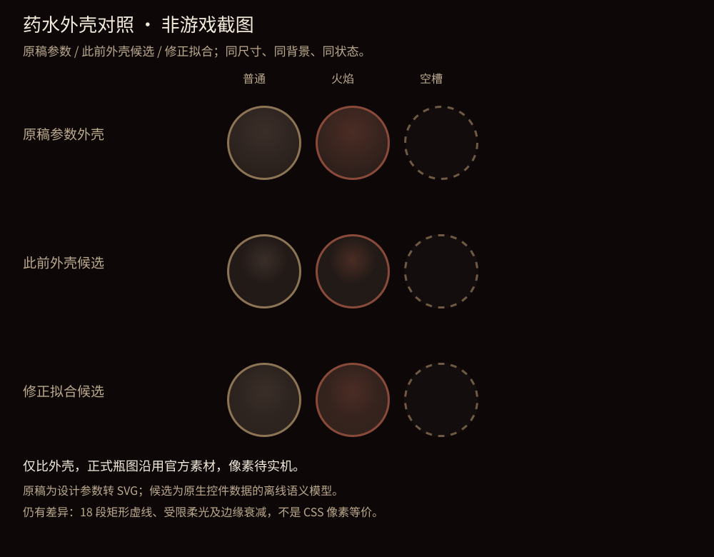

# 批准稿 UI 候选发布前核对（非整体验收）

本页更新此前记录里的“未推送/完整 check 待运行”阶段状态；历史证据不重写、不追认。

## 来源与线性合流

2026-10-28 16:58 UTC 核对 develop 为 `0763d2e7a4137a1f35d6a214922cb3ca938aa53c`（PR307）。从 `1f260a7` 到它仅有15个 CI/任务文档路径，与六个 UI 提交零重叠。已无冲突线性 rebase；源提交为 `d5284bcc82654f23a2643683ceeecda05e730548`。旧 `d6a0881` 保留在本地 `backup/dot-ui-pre-fast-ci-20261028`，原 `26614cb` 仍保留。逐一复算药水清单的25个源码/历史 SHA256 全部不变，原53fa历史层、原26源、golden、runner与预算均未改。

## 修改前后与限制

完整组合来源和阶段测试见[集成记录](../APPROVED-UI-CURRENT-INTEGRATION-20261028.md)，药水真实状态/源场比较见[纠偏记录](../potion-shell-integration-20261028/README.md)。

| 内容 | 修改前 | 当前候选 |
|---|---|---|
| 地图 | 路线节点圆圈、粗顶栏和常驻教学偏离批准稿 | 按冻结Map稿去圈、菱形当前位置、细顶栏/铜色菜单/必要返回；原选路几何与规则保留 |
| 卡面/详情/能量/Main | 共享卡面和主战斗表面仍有稿件偏差 | 逐块应用冻结卡面、详情A、能量和Main；继续保留PR302意图/输入安全合同 |
| 空药水槽 | 旧实心面/整圈边框 | 原稿半透明面与18段切线虚线近似 |
| 有药水槽 | 此前候选单小亮斑偏离整面径向色场 | 原稿明暗端点插值的双soft-disc近似；真实菜单/瞄准owner驱动选中 |

图由独立审查已检查的SVG/控件语义模型生成，仅比较普通/火焰/空槽的外壳，不画瓶子；当前源哈希与采用拟合一致。仍不是CSS/原生像素等价，也不证明选中态辉光、官方瓶图/染色或设备性能。原SVG同时保留为 `shell-only-compare.svg`。卡面离线对照在 `docs/design/evidence/card-face/compare.html`，现有旧PNG不认证新SVG。

## 本地实际结果

- rebase 后便携CI合同12/12；最终药水/Main/Map加inverse入口11/11；完整inverse合同6/6。网络、语法、架构221模块/1265边、静态73条旧诊断且零新增、原复杂度门槛均通过。日志及SHA256在 `verification-status.json`。
- 原 `d6a0881` 上两次完整 `npm run check` 均中断无结论：16:37:34启动的首次发生执行传输断开；16:42:41重试最后heartbeat为16:54:23，追踪会话已消失，16:59:19实查锁FREE，日志没有终止摘要/exit。旧JSON的running不是活进程证明。两份原日志完整保留；都不记PASS，也不推断为代码断言FAIL。不再第三次本地全量重跑。
- 新基线CI短回归首次14通过/1失败：失败项在 `tests/ci-downloads.test.mjs:60` 首次启动PowerShell时得到status null。最小直接探针确认当前云缺少 `pwsh`（ENOENT），不是下载语义断言失败。没有安装、跳过或改测试；实际PowerShell执行交托管Full Quality。
- 本地为Node24.22.1，不冒充托管24.18.0。完整托管Quality/inventory仍待该次发布的精确head。

## 合流顺序与产品边界

PR311（Battle UI）与本候选的battle控制器、架构/静态基线和历史接层重叠；PR310（Node UI）与node控制器、架构/静态基线和历史materializer重叠；PR312另有质量基线变更。它们尚未合入本候选，未替其他执行者改PR/工作区，后续须由主线程协调顺序并重新验证，不能互相整文件覆盖。

本次只提交单个Draft PR，正常合并仍等精确head完整CI及独立审查；没有正式Approve、合并、发布、用户Codex、客户端或键鼠动作。官方导入/ready、同候选PC和实体手机UI/性能、verify:ui仍未验证，TASK-4保持In Progress且所有整体验收AC不勾。
