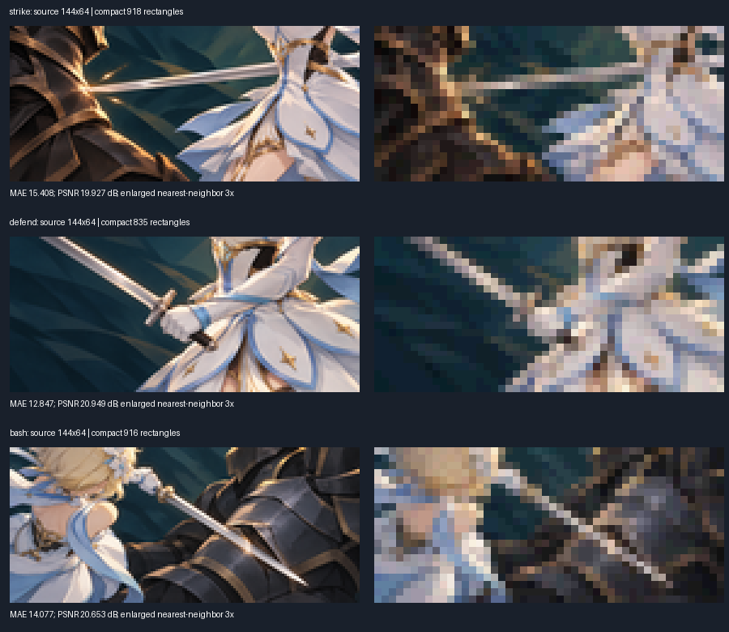

# TASK-94：同源 compact 基线审计

2026-11-01 从 develop `4f42212` 开始的独立离线切片。重新使用已有
`scripts/art/build-performance-pack.py::rectangles`，没有编写新拟合器、增加依赖、
修改生产资产或启用卡牌图元。TASK-94 的完整混合算法与官方设备 AC 均未完成，
其他 M4 任务不依赖本实验完成。

## 结果与可视检查



每侧输入/重建均为 144×64；对照图仅用 nearest-neighbor 放大3倍方便检查。
已查看实际 PNG：右侧明显损失细节且有马赛克，不宣称相同画质或质量胜出。
本实验锁定基线，未来成熟图元算法必须使用相同源 SHA、显示尺寸及可复现测量，
而不是更换成图库图标后声称压缩优势。

| 卡 | 矩形控件（不含容器） | hex文本字节 | RGB MAE | PSNR dB |
|---|---:|---:|---:|---:|
| strike | 918 | 12852 | 15.408 | 19.927 |
| defend | 835 | 11690 | 12.847 | 20.949 |
| bash | 916 | 12824 | 14.077 | 20.653 |

`results/results.json` 保存源图、配方、compact包和重建像素的 SHA256、编码SHA、
完整误差及本次生成耗时。三项编码与现有 compact-v1 逐字节相等。
数据字节只计14字节/矩形的hex文本，不是Lua包体、官方容量或内存。
MAE/MSE/PSNR直接对sRGB编码值计算，不是感知指标，也不是同画质通过线。
零误差PSNR用 `null` + `psnr_infinite: true` 表示，避免非标准JSON Infinity。

耗时仅单次离线 Python `rectangles` 调用，不含读取、验证、重建图、PNG写入；
不是FPS、游戏创建时间、官方冷载/缓存/安卓实测。没有重复挑最好时间。

## 复现

从仓库根目录（已有 Python/Pillow；本次 Python 3.12.14 / Pillow 13.0.0）：

```sh
python -m unittest discover -s experiments/art-tech-lab/baseline-audit -p 'test_*.py' -v
python experiments/art-tech-lab/baseline-audit/audit.py --output /tmp/card-baseline-audit
```

省略 `--output` 可重新生成本目录 `results/`；耗时随环境变化，像素/编码/hash和误差应稳定。
五项测试覆盖三张真实图重复生成、非法编码/越界/重叠/缺口、源hash/尺寸/透明、
LFS指针拒绝及独立已知值误差校验。继承配方的Pillow getdata弃用警告不影响本轮结果；
未改既有配方以避免把工具升级混入本切片。没有执行完整仓库Quality/官方GIA/游戏。

## 后续依赖与材料边界

- 背景/角色另需可解码且SHA吻合的同源素材；本次背景PNG是LFS指针，未冒充已测图。
- 先校验成熟拟合器源码/许可证及旋转、Alpha、越界与层序表达，再接入同源对比。
- 既有 Primitive 椭圆导出样本存在越界且无裁切，不能把离线PNG当实际平台效果。
- 只有离线质量有依据后才进入官方GIA、同候选PC/实体安卓、1/5/10卡有界缓存验证；
  正式启用仍需Owner批准，不能由本报告推断。
- 原图沿用仓库既有素材及其权利边界；本切片未下载或复制新的第三方拟合器代码。

## 衍生图来源与权利记录

[provenance.json](provenance.json) 逐项映射四张输出PNG的SHA256及三张既有输入图SHA256，
关联各卡 `generation-provenance.json` / `asset.json`。这三张输入在法律清单原属
`card-illustration-source-candidate`，输出沿用既有 `performance-art-derivative` 分类，
不是新许可。原神IP仍归原权利人；项目委托AI候选的既有使用限制不变，不转授游戏IP、
商业许可或暗示用户视觉/平台验收。对照图标签使用Pillow默认字体，不分发字体文件。
